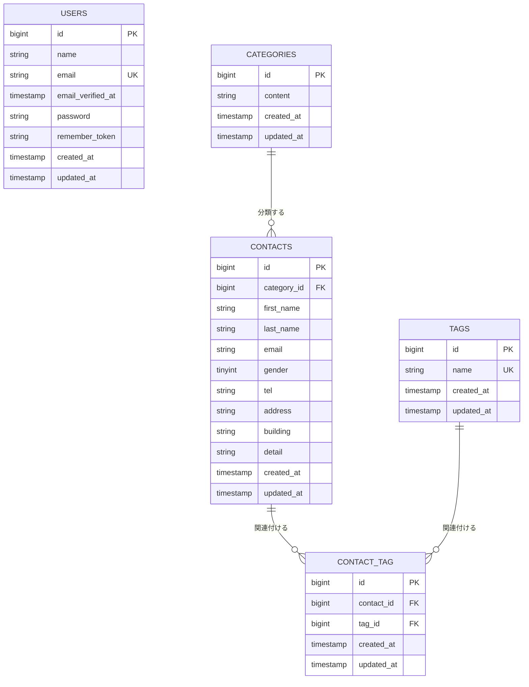

#プロジェクト名

COACHTECH お問い合せフォーム

#アプリケーション概要

本アプリケーションは、プロジェクトに関するお問い合わせを受け付けるためのフォームです。
ユーザーはお問い合わせ内容を入力し、確認画面で内容を確認してから送信できます。入力内容のバリデーションを行い、質問・要望・不具合報告・ご意見などのお問い合わせ情報をデータベースに保存します。

#実装した機能の概要説明

1.お問い合わせ機能
・お問い合わせ内容を入力するフォーム
・名前・性別・メールアドレス・電話番号・住所などの
　入力チェック（バリデーション）
・入力内容を確認してから送信する確認画面
・送信されたお問い合わせ情報をデータベースに保存する　機能
・お問い合わせ送信完了画面

2.管理者機能
・管理者の新規登録・ログイン・ログアウト機能
・ログインした管理者がお問い合わせ一覧を確認する機能
・お問い合わせの詳細を確認する機能
・お問い合わせに関連するタグの管理機能

3.Webアプリケーションの認証機能

Bladeテンプレートを使用してログイン画面や管理画面を作成しました。Laravel Fortifyによるログイン・ログアウト機能を実装し、セッション認証とCookieを利用してログイン状態を管理しています。

ログイン後に管理画面へ遷移すること、画面を再読み込みしてもログイン状態が維持されること、ログアウト後は管理画面へアクセスできないことをブラウザで確認しました。

#環境構築手順

1.動作環境(使用技術)
本アプリケーションは、以下の環境で動作します。

・PHP 8.2
・Laravel 10.x
・MySQL 8.0
・Nginx
・Docker
・Laravel Sail
・Node.js / npm
・Vite
・Tailwind CSS 3.4
・phpMyAdmin

環境構築を始める前に、Docker Desktop、Git、
Node.js / npm が利用できる状態にしてください。

2.リポジトリをクローンする

ターミナルを開き、プロジェクトを保存したい
ディレクトリに移動します。

以下のコマンドを実行して、GitHubからソースコードを取得します。

git clone リポジトリのURL

※ リポジトリのURLは、実際に公開しているGitHub
リポジトリのURLに置き換えてください。

クローンしたプロジェクトのディレクトリに移動します。

cd contact-form-app

以降のコマンドは、特に記載がない限り contact-form-appディレクトリ内で実行します。

3.環境設定ファイルを作成する

Laravelの環境設定ファイル .envを作成します。

cp .env.example .env

.envファイルを開き、データベースの接続設定を確認します。

DB_CONNECTION=mysql
DB_HOST=mysql
DB_PORT=3306
DB_DATABASE=laravel
DB_USERNAME=sail
DB_PASSWORD=password

DB_HOSTには localhostや 127.0.0.1ではなく、Docker Composeで設定されているMySQLサービス名 mysqlを指定します。

※ 実際の compose.yaml や .env.exampleでデータ
ベース名・ユーザー名・パスワードが異なる場合は、その設定に合わせてください。

4.Dockerコンテナを起動する

Docker Desktopを起動し、Dockerが利用できることを確認します。

PHPの依存パッケージをインストールする前に vendor
ディレクトリが存在しない場合は、Composerを利用して依存パッケージをインストールします。

composer install

Composerをローカル環境にインストールしていない場合は、PHP 8.2用のComposerコンテナなどを利用してください。

インストールが完了したら、Dockerコンテナをバックグラウンドで起動します。

./vendor/bin/sail up -d

コンテナの起動状態を確認します。

./vendor/bin/sail ps

MySQL、Laravelアプリケーション、Nginx、phpMyAdminなどの必要なサービスが起動していることを確認してください。

5.アプリケーションキーを生成する

Laravelの暗号化処理に使用するアプリケーションキーを生成します。

./vendor/bin/sail artisan key:generate

6.データベースのテーブル作成と初期データの投入

以下のコマンドを実行して、マイグレーションとシーダーを実行します。

./vendor/bin/sail artisan migrate --seed

マイグレーションではデータベースにテーブルを作成し、シーダーではカテゴリやタグなどの初期データを登録します。

※ シーダーが用意されていない場合は、./vendor/bin/sail artisan migrateを実行してください。

※ migrate:fresh --seedは既存のテーブルを削除して作り直すため、既存データがある環境では注意してください。

7.フロントエンドの依存パッケージをインストールする

Node.jsとnpmが利用できることを確認し、プロジェクトのルートディレクトリで以下のコマンドを実行します。

npm install

ViteやTailwind CSSなど、フロントエンドの動作に
必要なパッケージがインストールされます。

8.Vite開発サーバーを起動する

以下のコマンドを実行します。

npm run dev

開発中はこのコマンドを実行したターミナルを開いたままにしてください。停止する場合は Ctrl + Cを押します。

9.アプリケーションにアクセルする

ブラウザを開き、以下のURLにアクセスします。

・お問い合わせフォーム：http://localhost
・phpMyAdmin：http://localhost:8080

お問い合わせフォームが表示されること、入力画面から
確認画面へ進めることを確認してください。

phpMyAdminでは、設定したデータベースに接続し、
作成されたテーブルを確認できます。

10.トラブルが発生した場合

コンテナの起動状態を確認します。

./vendor/bin/sail ps

コンテナのログを確認します。

./vendor/bin/sail logs

設定変更後などにコンテナを再起動する場合は、以下を実行します。

./vendor/bin/sail down
./vendor/bin/sail up -d

#Laravel Pintによるコード整形

本プロジェクトでは、PHPコードの書式を統一するためにLaravel Pintを使用しています。

#コードの自動整形

コードをコミットする前に、次のコマンドを実行してPHPコードを自動整形します。

./vendor/bin/sail bin pint

#整形結果の確認

自動整形後、次のコマンドで書式に問題がないか
確認します。

./vendor/bin/sail bin pint --test

チェックに成功すると、対象ファイルのテストが PASS と表示されます。

#コミット前の手順

1./vendor/bin/sail bin pint` でコードを整形する。
2./vendor/bin/sail bin pint --test` で整形結果を確認する。
3git diffで変更内容を確認する。4.問題がなければ、変更したコードをコミットする。

以上で環境構築は完了です。

## ER図

#環境開発URL

お問い合わせフォーム
入力画面・トップページ

http://localhost

phpMyAdmin
データベースを確認する管理画面

http://localhost:8080

#作成者
角庵　真沙子
